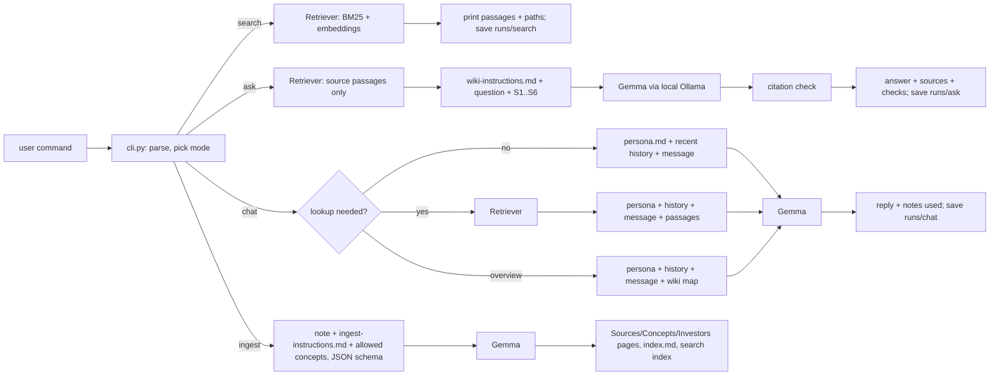

# Personal Investing Wiki: local Gemma + RAG

A personal wiki of my study notes on five investors (Warren Buffett, Howard Marks, Charlie Munger, Nick Sleep and François Rochon), with my own command-line harness around a **local Gemma 4 E2B** model. It has three modes that behave differently on purpose:

| Command | What it does | Uses the model? |
|---|---|---|
| `./wiki search "…"` | Returns the original passages and file paths that match. **No generated answer.** | No (works even with Ollama off) |
| `./wiki ask "…"` | Standalone factual answer from retrieved evidence, with `[S#]` citations, or `INSUFFICIENT EVIDENCE`. Never sees chat history or the persona. | Yes |
| `./wiki chat` | "Ledger", a study-partner assistant with conversation memory. It looks up notes only when a turn needs them. | Yes |
| `./wiki ingest vault/raw` | Reads sources, asks Gemma for structured page content, and writes linked Obsidian pages, `index.md` and the search index. | Yes |
| `./wiki --help` / `status` / `eval` | Help, model/memory/index status, and the ask-mode test runner. | — |

Everything runs on my MacBook Air (M1, 8 GB) with the internet off.

**Jump to:** [Setup](#2-setup-and-device) · [Commands](#3-cli-commands) · [Architecture](#4-architecture-how-my-data-reaches-the-model) · [Design choices](#5-design-choices) · [Wiki in Obsidian](#6-the-wiki-in-obsidian) · [Evidence](#7-evidence) · [Reflection](#8-reflection-limitation-and-improvement)

| Evidence | Link |
|---|---|
| CLI and harness code | [`src/wiki_cli/`](src/wiki_cli/) (entry point [`cli.py`](src/wiki_cli/cli.py)) |
| Wiki (Obsidian vault) | [`vault/`](vault/) → start at [`vault/index.md`](vault/index.md) |
| Four ask-mode evidence cards (offline) | [`evidence/ask-tests/`](evidence/ask-tests/) |
| Chat / search / ask mode checks (offline) | [`evidence/mode-checks/`](evidence/mode-checks/) |
| Offline demonstration transcript and recording | [`evidence/offline/`](evidence/offline/) |
| Obsidian screenshots | [`evidence/screenshots/`](evidence/screenshots/) |
| Earlier runs, failures and fixes | [`evidence/ask-tests/dry-run-*`](evidence/ask-tests/) and [§7.2](#72-how-the-tests-changed-the-system-failures-and-fixes) |

---

## 1. Purpose and sources

**What the wiki is for.** A second-year-MBA study aid on how great investors think about **risk, market psychology, business quality and temperament**. It should answer questions like *"How does Marks define risk?"*, *"What is Mr. Market?"* or *"Why does Nomad hold stocks for five years?"*, and help me plan study sessions, while showing exactly where each claim comes from.

**Sources.** I started from five PDF collections of investor letters. They are copyrighted and are **not** in this repo. From them I selected nine documents and wrote a Markdown study note for each: paraphrased, organised by section, with the PDF page numbers of every section. The notes were drafted with AI assistance directly from the PDFs, with a page reference for every section, so each claim can be checked against the original. These notes are the wiki's original sources, and they are preserved unchanged in [`vault/raw/`](vault/raw/): their SHA-256 hashes still match the ones recorded at ingestion in [`data/catalog.json`](data/catalog.json).

| Source note (`vault/raw/`) | Wiki page | Original document | PDF pages |
|---|---|---|---|
| `buffett-1987-letter.md` | Buffett 1987 Letter | Berkshire Hathaway letter for 1987 ([public](https://www.berkshirehathaway.com/letters/1987.html)) | 215-244 of *All Berkshire Hathaway Letters* |
| `buffett-1993-letter.md` | Buffett 1993 Letter | Berkshire Hathaway letter for 1993 ([public](https://www.berkshirehathaway.com/letters/1993.html)) | 390-416 |
| `buffett-1996-letter.md` | Buffett 1996 Letter | Berkshire Hathaway letter for 1996 ([public](https://www.berkshirehathaway.com/letters/1996.html)) | 468-494 |
| `marks-2001-cycles-memo.md` | Marks 2001 Cycles Memo | Oaktree memo "You Can't Predict. You Can Prepare." | 135-145 of *The Complete Collection* |
| `marks-2003-most-important-thing.md` | Marks 2003 Most Important Thing | Oaktree memo "The Most Important Thing" | 226-238 |
| `marks-2006-risk-memo.md` | Marks 2006 Risk Memo | Oaktree memo "Risk" | 334-345 |
| `munger-2016-daily-journal.md` | Munger 2016 Daily Journal Meeting | Daily Journal 2016 annual meeting transcript | 669-693 of *Charlie Munger Letters* |
| `sleep-2006-nomad-letter.md` | Nomad 2006 Annual Letter | Nomad Investment Partnership letter for 2006 | 101-114 of *Nick Sleep Nomad Letters* |
| `rochon-2002-giverny-letter.md` | Giverny 2002 Annual Letter | Giverny Capital annual letter for 2002 | 13-24 of *All Giverny Capital Annual Letters* |

**How originals connect to generated pages.** Each note's frontmatter carries a stable `source_id` (its filename), a readable `wiki_title`, and the original file and pages. Ingestion turns each note into:
- one **Source** page (`vault/wiki/Sources/<wiki_title>.md`);
- contributions to **Concept** pages (`vault/wiki/Concepts/`);
- a line on the author's **Investor** page (`vault/wiki/Investors/`).

Every generated page links back to the raw note. The source catalog at the bottom of [`index.md`](vault/index.md) and [`data/catalog.json`](data/catalog.json) map `source_id` → page → original document.

---

## 2. Setup and device

### Device (measured)

| | |
|---|---|
| Computer | MacBook Air (MacBookAir10,1), **Apple M1** (4 performance + 4 efficiency cores) |
| Memory | **8 GB unified memory** (CPU and GPU share it). Available before loading the model: 38-64% free (`memory_pressure`), depending on which other apps were open; ~7.5 GB in use during runs. |
| Dedicated VRAM | None (unified memory) |
| OS | macOS 26.2 |
| Free disk | ~122 GB of 460 GB |

### Model and runtime

| | |
|---|---|
| Model | **`gemma4:e2b-it-qat`**: Gemma 4 E2B, instruction-tuned, quantization-aware-trained, **Q4_0** (4-bit). Ollama reports 4.6B total parameters (E2B = ~2B *effective*; the rest is per-layer embeddings plus vision/audio encoders). Digest `07ea59a47401`, 4.3 GB on disk. |
| Embeddings | **`nomic-embed-text`** (137M parameters, F16, 274 MB), for local semantic search |
| Runtime | **Ollama 0.34.4** (macOS app) on the M1's Metal GPU |
| Official sources | Gemma docs: <https://ai.google.dev/gemma/docs/core> · Ollama model pages: <https://ollama.com/library/gemma4>, <https://ollama.com/library/nomic-embed-text> |
| Harness | Python 3.12, **standard library only** (no pip dependencies) |

### Why this model fits this computer

With 8 GB of shared memory, the course guidance is to start with a quantized E2B model and a short context. I checked the options in Ollama:

| Option | Size | Verdict |
|---|---|---|
| Default `gemma4:e2b` (Q4_K_M) | 7.2 GB | Too large for 8 GB |
| E4B | Larger still | Too large |
| 26B MoE | ~14 GB | Out of the question |
| **QAT Q4_0 build** | 4.3 GB on disk; **~3.6 GB mapped + ~1.3 GB process memory** when running (see below) | **Chosen.** The smallest Gemma 4 option. It fits, but only just, on an 8 GB Mac. |

Quantization-aware training means the 4-bit weights lose less quality than post-hoc 4-bit. My wiki is small (9 notes, 60 source passages), so ask mode only needs about 1,700 prompt tokens. E2B answers grounded questions correctly (§7), so I did not need a larger model, and a larger one would not fit. Its weaknesses show up in ingestion, which is why every generated page is reviewed (§5.7, §8).

### Measured memory and response time (this Mac, local)

**Memory is the real constraint on this machine, and my first setup crashed it.**

`ollama ps` reports only the part of the model placed on the GPU (1.7 GB at a 4K context), which understates real use. macOS showed the model process (`llama-server`) at **5.1 GB**: by default Ollama copied all the weights into RAM, including the unused vision/audio encoders and the large per-layer embedding tables. During an early rehearsal I also ingested with an 8K context, which uses more memory and forces a model reload when ask mode switches back to 4K. macOS ran out of memory, swapped ~4 GB to disk, and the screen process (WindowServer) froze for 2 minutes. The system watchdog then **force-restarted the Mac** (kernel panic report: *"userspace watchdog timeout: no successful checkins from WindowServer"*).

Two changes fixed it, both in [`config/settings.toml`](config/settings.toml):
1. **`use_mmap = true`**, sent with every Gemma call. The weights are memory-mapped from the model file instead of copied, so the process drops from **5.1 GB to 1.2-1.4 GB**. The mapped weights (~3.6 GB) are file cache that macOS can drop instantly instead of swapping.
2. **One 4,096-token context for every mode.** The largest note still fits: 2,237 prompt + 746 output tokens. No reloads between modes, and ingestion got faster (42 s instead of 77 s per source, 29 instead of 17 tok/s).

After the fix, a full monitored rehearsal (ingest + four tests + chat/search/ask checks) ran without problems. Free memory still dipped to 5-8% with the Claude app and background apps open, so for the offline run I quit everything except Terminal and the screen recorder.

| Task (after the fix) | Memory | Time |
|---|---|---|
| Ingest one source (~1,000 words → JSON page content) | model process ~1.3 GB + ~3.6 GB mapped weights | **42-48 s per source** (48.2 s in the offline run; ≈2,200-2,400 prompt tokens, ≈620-750 output tokens, ~29 tok/s; plus a one-time ~9 s model load) |
| Re-ingest unchanged sources | none (no model call) | < 1 s (saved extractions reused) |
| `ask` (6 passages ≈ 1,700 prompt tokens) | same model, already loaded; + 0.37 GB embedding model | **7-16 s warm**: 9.8 s, 9.8 s, 15.6 s and 7.1 s for the four tests in the offline run (6-11 s in the rehearsal); ~20 s cold including the model load |
| `chat` turn | same | ~6 s (capability questions) to 12-30 s (with notes or a long draft) |
| `search` | no generation model (embedding model 0.37 GB if Ollama is up) | 0.03-0.2 s |

`./wiki status` prints both numbers: what `ollama ps` reports, and the real macOS footprint of the model process. The offline run's own numbers are recorded in each evidence card and in [`evidence/offline/`](evidence/offline/).

### Setup (do this while online)

```bash
# 1. Runtime: install Ollama from https://ollama.com/download (macOS app) and open it once.
# 2. Models (downloaded once, stored locally in ~/.ollama/models):
ollama pull gemma4:e2b-it-qat
ollama pull nomic-embed-text
# 3. Code:
git clone https://github.com/gonzalomadrazo-pixel/personal-wiki.git
cd personal-wiki
chmod +x wiki scripts/*.sh
./wiki status            # checks Ollama, both models and memory
./wiki ingest vault/raw  # reuses the saved, reviewed extractions (no Gemma call) and builds the local search index
PYTHONPATH=src python3.12 -m unittest discover -s tests   # 23 model-free tests of the harness logic
```

I checked these steps on a fresh copy containing only the files in this repository: the tests pass, the link check passes and a cited `ask` works.

`./wiki` is a small launcher that runs the package from `src/` with any Python ≥ 3.12. There is nothing to `pip install`. With [uv](https://docs.astral.sh/uv/), `uv sync && uv run wiki …` also works.
If `uv run wiki` says `No module named wiki_cli` on macOS, run `chflags -R nohidden .venv`: macOS had marked the venv files hidden, and Python 3.12 skips hidden `.pth` files. The `./wiki` launcher avoids this.

Confirm everything is local before going offline: `ollama list` shows both models, and `./wiki status` shows `Ollama server: running` and both model digests.

---

## 3. CLI commands

```bash
./wiki --help                                   # commands, configuration, required inputs
./wiki ingest vault/raw                         # all sources → wiki pages + index.md + search index
./wiki ingest vault/raw/marks-2006-risk-memo.md # one source
./wiki ingest vault/raw --force                 # re-run Gemma even if unchanged (see §5.6)
./wiki search "Mr. Market"                      # original passages + paths, no answer
./wiki search "moat" --include-wiki -k 8        # also search generated wiki pages
./wiki ask "How does Howard Marks define risk?" --mode local
./wiki ask "…" --show-passages                  # also print the full retrieved passages
./wiki chat                                     # interactive assistant (/notes, /sources, /save, /reset, /exit)
./wiki status --check-network                   # model, runtime, memory, index, internet reachable?
./wiki eval                                     # run the 4 ask-mode tests → evidence/ask-tests/*.md
```

Configuration lives in [`config/settings.toml`](config/settings.toml): model names, temperatures, context sizes, passage size, top-k and chat history length. Environment overrides are `WIKI_MODEL`, `WIKI_EMBED_MODEL` and `OLLAMA_HOST`.
Errors are explicit:
- Ollama not running → "open the Ollama app or run `ollama serve`" (search still works, keyword-only).
- Model missing → "`ollama pull …`".
- Missing file → "Path not found".
- A PDF → "convert to Markdown notes first".
- `--mode online` → "not implemented; local is the default".

---

## 4. Architecture: how my data reaches the model

**The model does not read my files.** Gemma only sees the text my harness puts into each request.

| Piece | What it is here | Code |
|---|---|---|
| **Model** | Gemma 4 E2B running in Ollama. It generates text from the instructions and context it is given, and nothing else. | [`llm.py`](src/wiki_cli/llm.py) (HTTP client) |
| **Retrieval tool** | A local hybrid index over my notes: BM25 keyword scores plus `nomic-embed-text` cosine similarity, fused by reciprocal rank. It returns passages with path, section and PDF pages. It never generates text. `search` exposes it directly. | [`index.py`](src/wiki_cli/index.py), [`chunking.py`](src/wiki_cli/chunking.py) |
| **RAG workflow** | Ask mode: retrieve passages → put them in a prompt with the research rules → Gemma answers from them → check citations. RAG supplies context at answer time; **Gemma is not trained or fine-tuned**. | [`modes.py`](src/wiki_cli/modes.py) `run_ask` |
| **Harness** | Everything around the model: choosing the mode, loading the right instruction file, managing chat history, deciding whether chat needs a lookup, building prompts, calling Gemma, checking citations, handling errors, and saving every run. | [`modes.py`](src/wiki_cli/modes.py), [`ingest.py`](src/wiki_cli/ingest.py), [`evidence.py`](src/wiki_cli/evidence.py), [`evals.py`](src/wiki_cli/evals.py) |
| **CLI** | The terminal interface to the harness. | [`cli.py`](src/wiki_cli/cli.py) |



### One path traced through the code: `./wiki ask "How does Howard Marks define risk?"`

1. `cli.main()` parses the arguments and calls `cmd_ask()`. It checks that Ollama is up, loads [`settings.toml`](config/settings.toml), and prints the mode and model header.
2. `Retriever.search(question, k=6, kinds=("source",))` scores all 60 **source** passages. Generated wiki pages are excluded, because ask must cite original evidence. BM25 and cosine rankings are fused, and the top 6 are returned with path, section and PDF pages.
3. `modes.run_ask()` builds exactly two messages:
   - **system:** [`prompts/wiki-instructions.md`](prompts/wiki-instructions.md), the research rules;
   - **user:** `QUESTION: …` followed by `[S1] Marks 2006 Risk Memo — section "What risk really is", PDF pp. 337-338 (file: raw/marks-2006-risk-memo.md)` + passage text, and so on for S2…S6.

   There is **no chat history and no persona**, so each question is independent.
4. `OllamaClient.chat()` POSTs to `http://localhost:11434/api/chat` with `temperature 0.1`, `num_ctx 4096` and `think: false`, and streams tokens to the terminal.
5. `check_citations()` parses the `[S#]` markers and classifies the answer as `answered`, `insufficient` or `uncited`. It confirms every citation points to a passage that was actually sent, and lists sentences without a citation.
6. The CLI prints the citation check, which passages were cited, and timing (prompt/output tokens, tok/s). The full record — question, retrieved passages with scores, answer, check, stats, `chat_history_used: false` — is saved to `runs/ask/<timestamp>.json`.

### Chat: context and when it retrieves

`ChatSession` keeps the last 10 user/assistant messages as conversation context. For each turn, `decide()` applies explicit, inspectable rules, and the CLI prints which rule fired:

| Turn | Rule | Context sent to Gemma |
|---|---|---|
| `/notes <topic>` | explicit lookup | top 4 source passages |
| "make that shorter", "turn that into…" | **follow-up edit** → no lookup | persona + history |
| "what can you help me with?", "hi" | **capability / small talk** → no lookup | persona (it lists the real capabilities) + history |
| "main ideas", "study plan", "overview" | **overview** → the wiki map (concept and source lists from `index.md`, labelled "not evidence") | persona + history + map |
| mentions my notes/sources, or a known concept/investor (from `config/taxonomy.toml`) | lookup | persona + history + 4 passages, "cite as [S#]" |
| a question with a strong keyword match | lookup | same |
| anything else | general conversation | persona + history |

Only the plain user message is stored in history, never the passages. So evidence doesn't pile up in the 4K context, and **anything I say in chat never becomes source evidence**. Ask mode never reads chat history at all.

### Saved outputs

| What | Where |
|---|---|
| ask, search and ingest runs, plus each chat session | `runs/ask/`, `runs/search/`, `runs/ingest/`, `runs/chat/*.jsonl` — each labelled with `mode` and `execution: local` |
| Gemma's structured output per source, with its review | `data/extractions/` and `data/reviews/` |
| Graded test records | `evidence/` |
| Drafts saved with `/save` | `drafts/` (outside the vault, not evidence) |

---

## 5. Design choices

### 5.1 Passages and context limits
- Notes are split on their `## ` sections, then packed into passages of **≤ 220 words** without splitting a bullet. That gives 60 source passages; most sections become one passage.
- Each passage keeps its section title and PDF page range, so a citation lands on a specific place.
- Each note's one-line intro is **not** indexed. It describes the note rather than the source, and in the first test run it crowded real evidence out of the top results (§7.2).
- Ask sends **6 passages** (≈ 1,700 prompt tokens) inside a 4,096-token context. Chat sends 4 passages plus up to 10 history messages.
- Ingestion sends one whole note (≈ 1,000 words ≈ 2,200-2,400 tokens) inside the same 4,096-token context. It was 8,192 until the memory crash described in §2. The wiki is never sent whole.

### 5.2 Retrieval method
- **Hybrid.** BM25 catches exact terms ("Rule of Three", "beta"). `nomic-embed-text` catches paraphrases (test 2 asks whether risk "guarantees a bigger payoff"; the note says riskier investments must offer higher *expected* returns but "nothing guarantees" them).
- The two rankings are fused with reciprocal-rank fusion (k = 60), so no score calibration is needed.
- Embeddings are cached by passage hash in `data/index/`, so re-indexing only embeds new text.
- **Everything is local.** No hosted embeddings, and search falls back to BM25 if Ollama is off.

### 5.3 Research rules vs. personality
The two instruction files are kept separate, and the harness loads only the one for the current mode:
- [`prompts/wiki-instructions.md`](prompts/wiki-instructions.md) (ask): use only the passages; cite every sentence; be neutral and brief; start with `INSUFFICIENT EVIDENCE` only if *none* of the passages address the question, and answer if they do, even in different words; never attribute one author's view to another.
- [`prompts/persona.md`](prompts/persona.md) (chat): "Ledger", a warm, concise classmate talking directly to me. It lists what it can and cannot do, cites [S#] when given passages, labels plans as suggestions, never invents personal facts, and treats chat claims as conversation, not evidence.
- [`prompts/ingest-instructions.md`](prompts/ingest-instructions.md) (ingest): use only the note; pick concepts only from the allowed list; give the section each key point came from.

### 5.4 Model settings that affected results
- `think: false`. Gemma 4 has a thinking mode; turning it off gave faster, plain answers.
- `use_mmap: true` and a single 4K context in every mode. Without them the Mac ran out of memory and crashed (§2).
- Temperatures: ask 0.1, ingest 0.2, chat 0.6.
- Ingestion uses Ollama **structured outputs**: a JSON schema whose concept names *and* section headings are enums. Gemma therefore cannot invent page names or cite a section that doesn't exist.
- The harness ranks candidate concepts by keyword hits before asking. If Gemma skips a concept that is the title of a section, one small follow-up call asks about that section alone. This fixed E2B missing the "Rule of Three" concept in the Giverny letter on the first try.

### 5.5 Note names, folders and links (for Obsidian)
- `vault/` is the Obsidian vault:
  - `raw/`: unchanged source notes, named by `source_id`;
  - `wiki/Sources/`: 9 pages, e.g. `Marks 2006 Risk Memo.md`;
  - `wiki/Concepts/`: 21 idea pages, e.g. `Risk vs Volatility.md`, `Mr Market.md`;
  - `wiki/Investors/`: 5 author pages;
  - `index.md`: human landing page grouped by topic.
- Machine files (catalog, extractions, index, runs, tests) live **outside** the vault.
- Page names come from a curated vocabulary, [`config/taxonomy.toml`](config/taxonomy.toml), and each note's `wiki_title`. They are 2-6 natural words, and every page's first heading equals its filename. Machine IDs are kept in frontmatter (`source_id`, `raw_sha256`).
- **Every link carries its reason:**
  - concept → concept links use human-written reasons from the taxonomy (e.g. *Leverage → Margin of Safety: "leverage eats into the cushion that protects against loss"*);
  - source → source links name the shared concepts;
  - investor → investor links name the ideas they both discuss.

  The index links everything, but it isn't the only connection.

### 5.6 Re-ingestion without duplicates
- Pages are keyed by stable names (`source_id` → `wiki_title`, concept names from the taxonomy). Re-ingesting overwrites the same files.
- A SHA-256 of each raw note decides whether Gemma needs to run again. Unchanged notes reuse the saved extraction (verified: 35 wiki pages before and after, no Gemma calls).
- Generated pages that are no longer produced are deleted. Only pages marked `generated_by: wiki-cli` are touched; hand-written notes are safe.
- **Human review is a gate.** Once an extraction is reviewed (`"reviewed": true`), `--force` still runs Gemma but saves the new output as `data/extractions/<id>.candidate.json` for comparison. It never silently replaces reviewed content.
- [`scripts/check_links.py`](scripts/check_links.py) verifies every `[[link]]` resolves to exactly one note: **45 notes, 532 links, 0 broken, no duplicate names**.

### 5.7 Reviewing generated pages against the originals
After ingestion, [`data/reviews/`](data/reviews/) holds a word-overlap check of every statement Gemma produced; low-overlap statements are marked `CHECK`.

All ~110 statements were then read against the notes, and **34** were corrected in the extractions, not in the evidence. Every correction is listed with its reason in [`scripts/apply_review.py`](scripts/apply_review.py) and at the bottom of each `data/reviews/<id>.md`. Examples:
- Gemma wrote that Buffett says to *ignore* Mr. Market's prices. The note says you may ignore **or take advantage of** them, but never be guided by them.
- Gemma inverted Nick Sleep's circle-of-competence point.
- Gemma linked three concepts with "while not explicitly named… implies". Those links were removed.

---

## 6. The wiki in Obsidian

Open **`vault/`** (not the repo) as the vault. The graph preset is saved in `vault/.obsidian/graph.json`:
- filter `path:wiki/`;
- attachments hidden;
- colour groups for Concepts, Sources and Investors.

A reader's path: `index.md` → *Risk* → **Risk vs Volatility** → **Marks 2006 Risk Memo** → original note `raw/marks-2006-risk-memo.md` › "What risk really is (PDF pp. 337-338)" → page 337 of the PDF.

| Screenshot | File |
|---|---|
| An open note (short filename, matching heading, source references, related-note links) | [`evidence/screenshots/obsidian-note.png`](evidence/screenshots/obsidian-note.png) |
| The topic-organised index / page list | [`evidence/screenshots/obsidian-index.png`](evidence/screenshots/obsidian-index.png) |
| Graph view, filter `path:wiki/`, attachments off | [`evidence/screenshots/obsidian-graph.png`](evidence/screenshots/obsidian-graph.png) |

---

## 7. Evidence

### 7.1 The four ask-mode tests (final run: local, offline)

The questions and expected evidence were written **before** running ([`evals/questions.toml`](evals/questions.toml)). They are kept outside the vault so retrieval can't find the answer key. `./wiki eval` runs each question through ask mode and writes a card with:
- the question and expected sources;
- the retrieved passages with paths and scores;
- the model identity and digest, local/offline status and timing;
- the exact Gemma answer, the citation check, and my assessment.

| Test | Question | Card |
|---|---|---|
| 1 · direct, one source | What is Giverny Capital's Rule of Three? | [test1-direct.md](evidence/ask-tests/test1-direct.md) |
| 2 · paraphrased | Does taking on riskier investments guarantee a bigger payoff, according to Howard Marks? | [test2-paraphrased.md](evidence/ask-tests/test2-paraphrased.md) |
| 3 · two sources | How do Warren Buffett and Howard Marks each define investment risk, and do they agree that volatility is the right measure? | [test3-two-sources.md](evidence/ask-tests/test3-two-sources.md) |
| 4 · not in the wiki | What annual management fee does Giverny Capital charge its partners? | [test4-unanswerable.md](evidence/ask-tests/test4-unanswerable.md) |

**Results of the offline run** (Wi-Fi off, 29 Sep 2026 21:25; every card records `Network at run time: offline`):

| Test | Expected source retrieved | Answer | Time | Verdict |
|---|---|---|---|---|
| 1 · direct | Giverny › Rule of Three at **rank 1** | All three parts of the rule, each sentence cited [S1] | 9.8 s | **Pass** |
| 2 · paraphrased | Marks 2006 › risk-return line at **rank 1** | No guarantee: riskier assets must *offer* higher expected returns; cited [S1] | 9.8 s | **Pass** (opening sentence uncited; one repeated sentence) |
| 3 · two sources | Buffett 1993 at ranks 1 and 4; Marks 2006 at ranks 2 and 6 | Both definitions correct and cited; both reject volatility | 15.6 s | **Pass**, but hedges instead of concluding that they agree |
| 4 · not in wiki | none expected; Nomad's fee passage retrieved as a trap | `INSUFFICIENT EVIDENCE`; did not borrow Nomad's fees | 7.1 s | **Pass** |

Every claim was checked against its cited passage; the reasoning is in each card's *Assessment* section. Machine-readable results: [`evidence/ask-tests/summary.json`](evidence/ask-tests/summary.json).

### 7.2 How the tests changed the system (failures and fixes)

These runs were made online, before the offline demonstration, and are kept as evidence of what improved.

| Run | What happened | Change made |
|---|---|---|
| [dry run 1](evidence/ask-tests/dry-run-1-online/) | Tests 1, 2, 4 correct. **Test 3 failed partly.** Marks' actual definition ("What risk really is") was not retrieved: it ranked 6th, behind a note's one-line intro. Gemma also **garbled a detail**, merging two example stocks ("drifting from 50 to 80 and then falling from 50 to 20"). | Stopped indexing the short intro lines of notes (`chunking.py`). |
| [dry run 2](evidence/ask-tests/dry-run-2-online/) | Test 3: the definition was still 6th. **Test 2 regressed:** Gemma wrote `INSUFFICIENT EVIDENCE` and then answered correctly with citations. It over-refused because the question's wording ("guarantee") differs from the note's. | Ask `top_k` 5 → 6. Rewrote rule 4 of `wiki-instructions.md`: refuse only if *none* of the passages address the question; answer if they do "even in different words". |
| [dry run 3](evidence/ask-tests/dry-run-3-online/) | All four behave as expected. Test 3 now gives both definitions with correct citations, but hedges on "do they agree" instead of concluding that both reject volatility. The merged stock example still appears in its volatility sentence. | Kept as a known limitation (§8). |

### 7.3 Chat / search / ask mode checks

[`scripts/mode_checks.sh`](scripts/mode_checks.sh) runs the scripted chat turns in [`evals/chat_checks.txt`](evals/chat_checks.txt), then `search`, then a standalone `ask`. The offline transcript is [`evidence/mode-checks/transcript-20260929-212640.txt`](evidence/mode-checks/transcript-20260929-212640.txt) (its first line records `network: offline`). Earlier online rehearsals are in [`evidence/mode-checks/dry-run-online/`](evidence/mode-checks/dry-run-online/). The offline run behaved the same way as the rehearsals:

| Check | Expected | Observed |
|---|---|---|
| chat: "what can we do?" / "what can you help me with?" | Real capabilities, **no lookup**, no citations, no refusal | No lookup ("conversational / capability question"); lists study plans, drafting, flashcards, notes lookup |
| chat: "What does Buffett mean by Mr. Market?" | Lookup, cited | Lookup ("mentions wiki topic 'mr. market'"), inline [S1] [S3] [S4] citations to the 1987 and 1993 letters |
| chat: "Draft a short 5-day study plan…" → "make that shorter" | Plan, then a shorter version built from the **conversation** | Plan built from the wiki map across all four topic groups; "make that shorter" → no lookup ("follow-up edit"), clearly shorter |
| chat: "Howard Marks told me the best time to buy is always in January" | Treat as conversation, not evidence | Looked up Marks' notes and pushed back (contrarian, price vs value, no calendar rule) |
| `search "Mr. Market"` | Original passages and paths, **no answer** | 3 passages with paths and PDF pages; "No answer is generated in search mode" |
| `ask "According to Howard Marks, when is the best time to buy stocks?"` | Standalone, cited, **never "January"** | Cited answer from Marks 2003 (price vs value, only unpopular assets are cheap, patient opportunism); no mention of January |

Two chat problems found in the first rehearsal were fixed:
- It referred to "Gonzalo" in the third person while talking to me. The persona now says to address him as "you".
- It answered a notes question without inline citations. Passages now end with an explicit citation instruction, and the CLI shows whether the reply cited them.

Remaining flaws, seen in the offline run:
- **Blurred attribution.** Under the heading "what Howard Marks is actually saying", the January reply included a point from Buffett's 1987 letter (volatility helps real investors, [S3]) without naming Buffett. Another Buffett point in the same reply *was* attributed correctly.
- **Overstatement.** It wrote that extrapolating trends is "*the* most dangerous thing"; the note says "one of the most dangerous".

The citations were correct in both cases, and it labelled its own view as "My take". Small-model paraphrasing like this is the limitation discussed in §8.

### 7.4 Offline demonstration

[`scripts/offline_demo.sh`](scripts/offline_demo.sh) is run with **Wi-Fi off**. It records the Wi-Fi state and a failed internet probe, then runs:
- `status --check-network` and `--help`;
- a real Gemma ingestion of one source, and a full re-ingest that must create no duplicates;
- all four ask tests and the mode checks.

| Evidence | File |
|---|---|
| Full terminal transcript | [`evidence/offline/offline-demo-20260929-212444.txt`](evidence/offline/offline-demo-20260929-212444.txt) |
| Screen recording (3 min 25 s, 720p): Wi-Fi off, status, ingestion and the four tests; stopped as the chat/search checks began (those are in the transcripts) | [`evidence/offline/offline-demo-recording.mov`](evidence/offline/offline-demo-recording.mov) |
| Live interactive chat, typed by me right after the demo, same Terminal session | [`evidence/offline/live-chat-20260929-212430.txt`](evidence/offline/live-chat-20260929-212430.txt) |

What the transcript shows, in order:
1. **No internet:** `Wi-Fi Power (en0): Off`; `curl https://www.google.com` fails with *Could not resolve host*; `./wiki status --check-network` reports `offline (no internet connection)`.
2. **Local weights:** `ollama list` shows `gemma4:e2b-it-qat` (4.3 GB) and `nomic-embed-text` (274 MB) on disk.
3. **Help:** `./wiki --help` prints the commands, configuration and required inputs.
4. **Real Gemma ingestion offline:** `ingest vault/raw/rochon-2002-giverny-letter.md --force` sent 980 words to Gemma and got 6 concepts and 6 key points in **48.2 s**. Because that source is already reviewed, the output was saved as a comparison candidate and the reviewed page was kept (§5.6).
5. **Re-ingestion creates no duplicates:** `ingest vault/raw` reused all 9 extractions in < 1 s, and `find vault/wiki` lists the same **35 pages**.
6. **The four ask tests:** the results in §7.1.
7. **Memory after the run:** `llama-server` footprint 1.35 GB, Gemma's mapped weights 3.59 GB, embedding model 0.37 GB. With the screen recording, the Claude app and Obsidian also open, free memory fell to **6%** and swap reached **8.2 GB**. The Mac slowed but did not crash, unlike the first rehearsal (§2).
8. **Mode checks:** chat, search and ask, as in §7.3.

**The live chat** ([transcript](evidence/offline/live-chat-20260929-212430.txt)):
- "what can you help me with?" → capabilities, no lookup.
- "Draft a 3-bullet plan to study risk" → cited plan from the Marks 2006 and Buffett 1993 notes.
- "…is there any stock you would recommend me buying as of today?" → it declined: no personalised investment advice.

Two honest caveats:
- **Merged turns.** I typed the next message while an answer was still streaming, so "make that shorter" and my next question were read as one turn. The reply began "Here is a shorter summary…" and answered a question about high valuations with loosely related Marks passages (inefficient markets, leverage). That is a retrieval-relevance weakness.
- **Wi-Fi during the live chat.** The live chat started 90 seconds after the screen recording stopped. I can't show from the logs exactly when Wi-Fi was turned back on. Chat only talks to the local Ollama server either way.

---

## 8. Reflection: limitation and improvement

**Limitation: a 2B-effective model makes small but real errors, mostly when it summarises.**
- **Ingestion.** About 30% of the statements Gemma E2B wrote for the wiki needed correction: 34 of ~110, including one inversion of meaning and several "implied" concept links. The structured-output schema stopped it from inventing page names or sections, but not from overstating or mis-paraphrasing.
- **Ask mode.** Grounded in 6 short passages, it is much more reliable. The one persistent error is test 3's merged stock example, where two examples from the same sentence were blended into one.
- **Chat.** It occasionally blurs which author said what (§7.3).
- **Cause.** A small quantized model compresses and paraphrases aggressively. Tighter prompts and a low temperature reduced these errors but did not remove them. The word-overlap review check catches unsupported *words*, not wrong *meanings*, so a human read was still needed.

**Improvement I would try next: a claim-level verification pass in ask mode.** After Gemma answers, the harness would split the answer into sentences and send each sentence with only its cited passage to a second, short Gemma call. The call would ask "Is this sentence fully supported by this passage? Answer yes/no and quote the unsupported part." Unsupported sentences would be flagged before display. It costs one short call per sentence (~1-2 s each on this Mac) and targets exactly the failure seen in test 3. The same checker could replace the word-overlap heuristic in ingestion review.

A second, smaller improvement: add diversity (MMR) to retrieval for "compare X and Y" questions, guaranteeing passages from both authors. That would make test 3 robust without raising top-k.

---

## Optional online mode

Not implemented. `--mode online` is accepted only to print a clear message; local is the default and the only execution mode, and no data leaves the computer.

## How this was built

This project was built with an AI coding assistant (Claude Code), following the course's starter prompt. The assistant helped:
- write the harness code, prompts and tests;
- draft the study notes from the PDFs;
- run and document the evaluations.

Every command output, measurement, test answer and failure in this README comes from real runs on this Mac, saved in [`runs/`](runs/) and [`evidence/`](evidence/). Nothing was edited to look better. The corrections to Gemma's wiki output are listed individually in [`data/reviews/`](data/reviews/).

## Repository layout

```
wiki                      launcher (./wiki …)
src/wiki_cli/             harness: cli, config, llm (Ollama client), chunking, index (retrieval),
                          modes (search/ask/chat), ingest, evals, evidence
prompts/                  persona.md (chat) · wiki-instructions.md (ask) · ingest-instructions.md
config/                   settings.toml · taxonomy.toml (allowed page names + link reasons)
vault/                    the Obsidian vault: raw/ (original notes), wiki/ (generated pages), index.md
data/                     catalog.json, extractions/ (Gemma output), reviews/ (checks + corrections)
evals/                    questions.toml (answer key, outside the vault), chat_checks.txt
evidence/                 ask-test cards, mode checks, offline demo, screenshots
runs/                     every saved ask/search/chat/ingest run
scripts/                  offline_demo.sh, mode_checks.sh, check_links.py, apply_review.py
```

No model weights or credentials are committed. The weights stay in `~/.ollama/models` and are downloaded from the official Ollama library as shown in §2.
